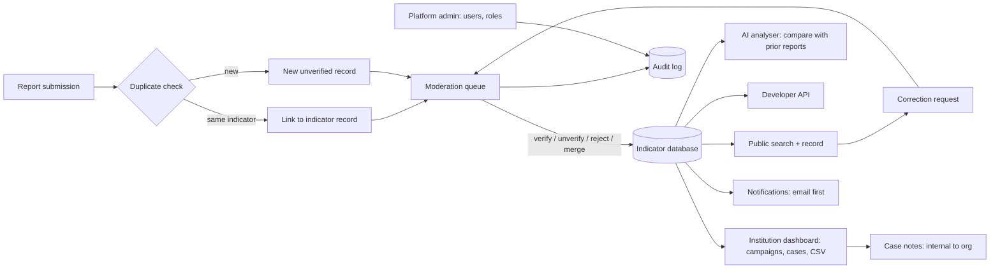

# Information architecture

## Sitemap (routes are the prototype hash routes)
```
Public
  /                      Check (home + search)
  /search?q&type&status&risk   Results
  /i/{id}                Indicator record
  /correct/{id}          Correction request
  /report                Report flow (6 steps)
  /analyse               Message analyser
  /about                 How we label things
  /login /register /recover /mfa
Signed in
  /mine                  My reports (reporter)
  /notifications         Preferences + recent
  /settings              Profile, security, data rights
Moderation (moderator, admin)
  /mod                   Queue
  /mod/{reportId}        Review
  /mod/corrections       Correction requests
  /audit                 Audit log
Institution (analyst; org admin adds users/keys)
  /org  /org/campaigns  /org/cases  /org/exports  /org/alerts
Developer
  /dev  /dev/docs  /dev/usage  /dev/try
Platform admin
  /admin  /admin/roles  /audit
Utility
  /states                UI states reference
```

## Navigation per role
| Role | Primary navigation (mobile tab bar shows first five) |
|---|---|
| Visitor | Check, Report, Analyse, Sign in |
| Registered reporter / Verified contributor | Check, Report, Analyse, My reports, Alerts |
| Moderator | Queue, Corrections, Audit log, Public check, Alerts |
| Organization analyst | Dashboard, Campaigns, Cases, Exports, Alert rules, Public check |
| Organization administrator | Analyst navigation plus Users and API keys (design only; prototype folds into analyst and developer views) |
| Developer (organization member) | Keys, Docs, Usage, Try, Public check |
| Platform administrator | Users, Roles, Audit log, Moderation, Public check |

Public roles use a top nav on desktop and a bottom tab bar on mobile. Staff roles use a left sidebar on desktop (at 900px and up) and the bottom tab bar on mobile. Account menu: profile, notifications, language, "How we label things", sign out. Role gating shows an explanatory "restricted" page, never a blank 404.

## Module relationships


## Data objects
Report (submission, reporter pseudonym, consent, evidence refs) -> Indicator (type, value, first reported, last observed, independent reports, evidence refs, verification status, confidence, risk category, source, review history) -> Campaign (group of indicators) -> Case (org-private, with notes). Correction request attaches to an Indicator. Audit entry attaches to any action. API key belongs to an organisation.

## Content rules
Status ladder: Reported, unverified; Under review; Verified with evidence; Correction requested. Risk wording: Higher risk, Some warning signs, Few warning signs, Not enough information. Copy keys are grouped by screen so Kiswahili can be added without layout changes.
